# Data Architecture & Persistence Layer

The application persists 17 PostgreSQL tables in the hosted Supabase database through raw SQL and the `pg` driver; it does not use an ORM. The browser also maintains encrypted local state for offline use and queues changes for later synchronization.

## Database Configuration

| Service/Module | DB Type | Profile/Environment | Driver | Connection | Migration Tool |
|---|---|---|---|---|---|
| Application API | PostgreSQL on Supabase | Hosted/serverless when configured; local browser storage when unavailable | `pg` | TLS-enabled pooled connections; pool max 6, 7-second connection timeout, 10-second idle timeout, and 60-second application idle eviction | In-process `initDatabaseSchema` and `runSchemaMigrations` in `src/api/db.ts`; no versioned migration framework |
| Browser offline storage | Browser localStorage | Offline/local mode | Web Crypto plus browser Storage API | AES-GCM ciphertext; the encryption key is also stored in localStorage | `src/utils/secureStorage.ts` migration helper; no SQL schema |

Schema creation and additive/compatibility changes run from application code. On each cold server process, the app now runs the idempotent `initDatabaseSchema` before `runSchemaMigrations`, ensuring missing base tables are created for existing as well as new databases. There are no SQL seed files or declared per-environment database profiles. The schema initializer itself does not seed general business records.

The PostgreSQL connection enables TLS with server-certificate verification. The six-connection pool limit is per Node process, not per deployment; total possible connections therefore grow with the number of serverless instances.

## Data Ownership per Service

| Service | Tables Owned | ORM Framework | Caching | Notes |
|---|---|---|---|---|
| Shared application persistence (`src/api/db.ts`) | All 17 tables listed below | None; parameterized SQL with `pg` | Per-process PostgreSQL pool cache; no query/result cache | Pull, push, deletion, and schema setup use a shared database. Authentication also accesses `users` directly through `src/api/auth.ts`. |
| Browser application | No PostgreSQL tables; local copies of application state | None | Encrypted localStorage and an offline sync queue | Local state is a fallback/cache, not an independent relational database. |

## Entity Model

All tables use a string `id` primary key unless noted. The physical schema is created and mapped in [`src/api/db.ts`](../../../../../src/api/db.ts); TypeScript contracts are in [`src/types.ts`](../../../../../src/types.ts). Table ownership is shared by the application API, not divided into independently deployed services.

### Table-by-table connection inventory

| Table | Primary/Unique Keys | Important Data | Connections and Persistence Notes |
|---|---|---|---|
| `users` | `id` PK; `username` unique; partial unique index on normalized officer role, excluding Member and Board Member | Password hash, role, approval state, contact/farm profile, MFA and password-reset state | No FK to `members`. Application code matches some profiles by ID, member number, or name. Passwords are bcrypt hashes; TOTP secrets are stored as text. |
| `members` | `id` PK | Name, farm location, crops, phone, member and RSBSA numbers, birth date, gender | No FK to `users`; profile pairing is application-level and can use multiple matching attributes. |
| `meetings` | `id` PK | Meeting details, minutes, attendance count, `attendance_record` JSONB, minute approval status/by/date/remarks | Attendance is embedded JSON, not a participant/join table. No FK to members or users. Minute approval fields are now included in the schema and fetch/save mapping. |
| `resolutions` | `id` PK | Resolution number, title, dates, movers/seconders, vote counts, status | No meeting or user FK; participant names are stored as text. |
| `financial_transactions` | `id` PK | Type, category, amount, dates, `activity_id`, `fund_source`, purpose/deadline, audit and presidential approval fields | `activity_id` now has a deferred FK to `activities.id` with `ON DELETE SET NULL`; legacy dangling IDs are nulled before validation. `fund_source` remains a text snapshot, not a stable `organization_funds.id`. Actor names are text. Purpose and liquidation deadline are persisted, with existing values preserved when a sync omits them. |
| `announcements` | `id` PK | Title, category, content, date, priority | `posted_by` is text; no user FK. |
| `system_logs` | `id` PK | Timestamp, user/role/action/details, hash and previous hash | Actor and role are snapshots as text; no user FK. |
| `afa_igp` | `id` PK; application uses `main_state` | Herd count/breakdown, produces and years as columns; expenses, sales, groups, and chore/egg logs as JSONB | One state/snapshot row is the aggregate for IGP data. Nested records do not have relational constraints. Egg harvest logs are read from `chore_logs`. |
| `afa_igp_expenses` | `id` PK | Expense `produce`, date, full `expense_data` JSONB | Segmented copy of expenses also held in `afa_igp.expenses`; indexed by `produce`. Fetch merges rows by expense ID, with segmented rows taking precedence. There is no FK to `afa_igp`. |
| `products` | `id` PK | Catalog identity, category, description, price/unit, stock, publication, farmer/contact fields | Rental inventory association is stored from `inventory.catalog_product_id`; the reference now has an FK with `ON DELETE SET NULL`. |
| `inventory` | `id` PK | Asset name/category, quantity, damaged count, condition, location and custodial notes | Optional `catalog_product_id` FK to `products.id`; legacy dangling IDs are nulled before constraint validation. |
| `activities` | `id` PK | Title, schedule, location, organizer, status, audience, attendance count | Referenced by a deferred FK from `financial_transactions.activity_id`; deleted activities clear the optional reference. |
| `achievements` | `id` PK | Year, title, descriptions, icon | Standalone table; no relational links. |
| `organization_funds` | `id` PK | Name, code, initial/current balances, category, source, custodian | Transactions refer to a textual fund source, not a fund ID. Fund code is intentionally not unique. |
| `auditor_reports` | `id` PK | Period/type, totals, findings, recommendations, preparer/certifier and status | Totals and names are report snapshots; no FK to transactions or users. |
| `delegation_requests` | `id` PK | Requester/reviewer names, reason, date range, status and remarks | Requester/reviewer are text; no FK to users. |
| `sync_queue` | `id` PK | Timestamp, action, entity type and JSONB payload/status | Polymorphic `entity_type` has no FK. No application SQL read/write use was found; the active offline queue is maintained in browser localStorage. |

### Observed schema and relationship gaps

- Database FKs now protect transaction-to-activity and inventory-to-product ID references. Fund source, actor names, and user/member profile matching remain text/application-level associations and are not relational FKs.
- Schema initialization now creates all base tables idempotently before applying migrations, including `inventory` for existing deployments. Migration cleanup nulls old dangling activity/product IDs before validating the new constraints; the related transaction or inventory record is retained.
- Both database status paths now include all 17 tables, including `inventory`, `achievements`, and `sync_queue`.
- Meeting-minute approval and transaction purpose/deadline fields are now present in SQL, pull mappings, and save mappings.
- Most date/time values are stored as `VARCHAR`, not PostgreSQL date/timestamp types. This permits inconsistent formats and makes ordering/index behavior dependent on string representation.
- `afa_igp.expenses` and `afa_igp_expenses.expense_data` duplicate expense content. The merge-by-ID rule is important to resolve copies, but the schema does not enforce that correspondence.
- Only the username/role constraints and the `afa_igp_expenses.produce` index are created explicitly. The tables queried or sorted by activity, transaction, meeting, and log dates have no corresponding secondary indexes in this schema.

```mermaid
erDiagram
    activities ||--o{ financialTransactions : "deferred FK; set null on delete"
    organizationFunds o|--o{ financialTransactions : "fund source text match; no DB FK"
    products o|--o{ inventory : "nullable FK; set null on delete"
    afaIgp ||--o{ afaIgpExpenses : "expense copies matched by id; no DB FK"

    users {
        string id PK
        string username UK
        string name
        string role
        boolean isApproved
        string password "bcrypt hash"
        string totpSecret
    }
    members {
        string id PK
        string name
        string memberIdNumber
        string rsbsaNumber
        string contactNumber
        string farmLocation
    }
    meetings {
        string id PK
        string title
        string date
        json attendanceRecord
        string minutesApprovalStatus
        string approvedBy
        string approvedDate
    }
    resolutions {
        string id PK
        string resolutionNumber
        string title
        string dateAgreed
        string status
    }
    financialTransactions {
        string id PK
        string type
        decimal amount
        string activityId FK "nullable; deferred"
        string fundSource
        string purpose
        string liquidationDeadline
        string auditedStatus
    }
    announcements {
        string id PK
        string title
        string postedBy
        string datePosted
    }
    systemLogs {
        string id PK
        string timestamp
        string userName
        string action
        string hash
    }
    afaIgp {
        string id PK
        int openingHogCount
        json herdBreakdown
        json expenses
        json sales
        json choreLogs
    }
    afaIgpExpenses {
        string id PK
        string produce
        string date
        json expenseData
    }
    products {
        string id PK
        string name
        string category
        decimal price
        string stockStatus
    }
    inventory {
        string id PK
        string name
        int quantity
        int damagedQuantity
        string catalogProductId FK "nullable"
        string itemCondition
    }
    activities {
        string id PK
        string title
        string scheduledDate
        string organizer
        string status
    }
    achievements {
        string id PK
        string year
        string title
    }
    organizationFunds {
        string id PK
        string name
        string code
        decimal initialFund
        decimal currentBalance
    }
    auditorReports {
        string id PK
        string reportPeriod
        decimal totalIncome
        decimal totalExpenses
        string preparedBy
    }
    delegationRequests {
        string id PK
        string requestedBy
        string reviewedBy
        string status
    }
    syncQueue {
        string id PK
        string entityType
        string action
        json payload
        string status
    }
```

<!-- mermaid-checked: every attribute is `<type> <name> [<key>] ["<description>"]` with at most one of PK/FK/UK, no \n in descriptions, no {} in descriptions, every relationship label is double-quoted -->

The diagram distinguishes application-level links from enforced relational constraints. Most tables are independent records; names and embedded JSON are used instead of normalized actor, attendance, and child-record relations.

## Key Repository Methods

There are no repository interfaces or ORM-derived CRUD methods. The shared persistence module exposes raw-SQL operations:

| Service | Repository/Source | Notable Methods | Purpose |
|---|---|---|---|
| Shared persistence | [`src/api/db.ts`](../../../../../src/api/db.ts) | `getPool`, `ensureDatabaseSchema`, `initDatabaseSchema`, `runSchemaMigrations` | Configure per-process pool and initialize/migrate the PostgreSQL schema. |
| Shared persistence | [`src/api/db.ts`](../../../../../src/api/db.ts) | `fetchAllDataFromPostgres` | Read each application table and map SQL columns into client state; joins are mostly absent. |
| Shared persistence | [`src/api/db.ts`](../../../../../src/api/db.ts) | `saveFullStateToPostgres`, `saveEntity`, `saveIgpExpenseSegments` | Transactional state persistence with per-table upserts and specialized expense synchronization. |
| Shared persistence | [`src/api/db.ts`](../../../../../src/api/db.ts) | `deleteEntityFromPostgres`, `lookupEntityTable`, `getTableStats` | Entity-name deletion mapping and database record-count reporting. |
| Authentication | [`src/api/auth.ts`](../../../../../src/api/auth.ts) | Direct parameterized queries against `users` | Login, password changes, MFA, and account operations; no repository abstraction. |

## Caching Strategy

The server caches PostgreSQL `Pool` instances by normalized connection string in process memory and evicts an idle pool after 60 seconds. This is connection pooling, not query-result caching; no Redis, ORM cache, or second-level cache is configured. Browser state is persisted in localStorage using AES-GCM with a locally stored key, supporting offline reads and queued writes. Because the key is stored in the same origin storage, this should not be treated as protection against same-origin script execution.

## Data Ownership Boundaries

All server-side modules share one PostgreSQL database and one schema; there are no database-per-service or schema-per-service boundaries. The application API performs cross-entity access and pushes/pulls state, while authentication queries the user table directly. Cross-table links are primarily text or ID conventions in application code, not joins backed by foreign keys. Most read paths fetch table collections independently; IGP is the exception, combining a state row with the segmented expense table by expense ID. Browser localStorage is an offline replica and synchronization queue, not a separate authoritative data service.

### Data Classification & Sensitivity

| Entity | Sensitive Fields | Classification | Controls in Place |
|---|---|---|---|
| `users` | Name, username, phone, farm location, member/RSBSA IDs, avatar, password hash, MFA secrets | PII and authentication secrets | Passwords use bcrypt; MFA secrets are stored as text. API returns safe user projections, but field-level encryption and DB RLS policies were not found. |
| `members` | Name, phone, address/location, birth date, gender, government/association IDs, avatar | PII | Server-side field sanitization; no field-level encryption or masking found. |
| `meetings` | Attendance entries and minutes may identify members | PII in embedded records | JSONB storage; no row-level DB policy found. |
| `resolutions` | Mover/seconder names | PII | Stored as text; no field-level control found. |
| `financial_transactions` | Amounts, descriptions, recorded/audited names | Financial/business data and PII; no PCI fields found | Application role checks and server-side sanitization; no field-level encryption or masking found. |
| `announcements` | Poster name | PII | Stored as text; no user FK. |
| `system_logs` | User name, role, actions and details | PII and security/audit data | Hash-chain fields are stored; no field-level masking found. |
| `afa_igp` | Member names in groups and egg-harvest submitter details in JSON | PII and operational data | JSONB persistence; no field-level encryption or RLS found. |
| `afa_igp_expenses` | Expense payload may include recorded-by details | PII and financial/operational data | JSONB payload; no field-level masking found. |
| `products` | Farmer name, phone, sitio/location, contact person | PII | Catalog publication controls; no field-level masking found. |
| `inventory` | Recorder name and location/notes | PII and operational asset data | No field-level encryption or masking found. |
| `activities` | Organizer, audience and participant-related notes | PII may be present | Application-level access; no user/member FK. |
| `achievements` | None identified in the schema | None | No sensitive fields identified. |
| `organization_funds` | Custodian name and financial balances | Financial/business data and PII | No field-level encryption or masking found. |
| `auditor_reports` | Preparer/certifier names and financial findings | Financial/business data and PII | Report-level status fields; no FK or field-level masking found. |
| `delegation_requests` | Requester/reviewer names and remarks | PII and governance data | Names stored as text; no user FK. |
| `sync_queue` | Payload may contain any synchronized entity data | Inherits the sensitivity of its payload | No server-side queue use was found; no field-level encryption or masking found. |

No PHI or payment-card data was identified in the modeled schema. Database encryption-at-rest and RLS configuration are not established by the repository; confirm provider-side settings separately. TLS certificate verification is enabled for both the persistence and status pools.
