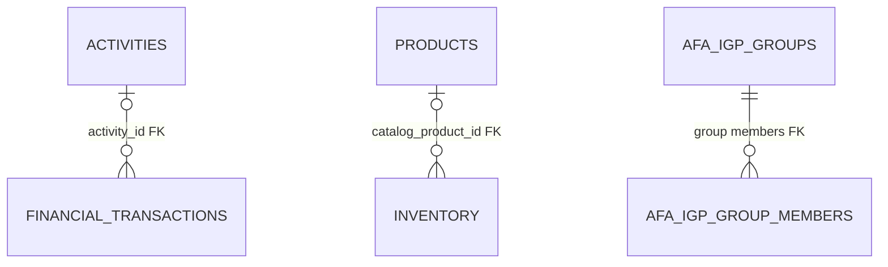

# Alegria Farmers Association — Database Schema Analysis

Source of truth: `src/api/db.ts` → `initDatabaseSchema()` (table creation) + `runSchemaMigrations()` (additive migrations), cross-checked against the domain types in `src/types.ts` and the entity router `ENTITY_TABLE_MAP`.
Companion diagram: [`docs/ERD.md`](./ERD.md).

---

## 1. Database at a glance

| Property | Value |
|---|---|
| Engine | PostgreSQL (Supabase, accessed over the pooler with TLS) |
| Schema | `public` |
| Tables | **20 application-managed tables** |
| Primary keys | Tables use client-generated `VARCHAR(100)` IDs except `afa_igp_group_members`, which has a composite primary key |
| Foreign keys | **3 in the repository-managed schema** — transaction-to-activity, inventory-to-product, and IGP group-member-to-group |
| Unique constraints | `users.username`; partial unique index on normalized officer `role` |
| Audit | `system_logs` is a SHA-256 hash chain (`hash`, `previous_hash`) |
| Sync model | Offline-first: queued operations stay in encrypted browser storage; state is pushed/pulled through `api/sync/{push,pull}.js` |

Many cross-entity references are *name strings* (`recorded_by`, `posted_by`, `organizer`, `moved_by`) or *embedded JSONB*, not FK columns. IGP expenses, sales, groups, group members, and harvests are now persisted in normalized tables, with JSON retained as a compatibility mirror and read fallback.

---

## 2. Tables (enumerated)

### 2.1 Core identity

**`users`** — officer & member login accounts.
- PK `id`; `username` UNIQUE NOT NULL; `password` (bcrypt hash) NOT NULL; `name`, `role`, `is_approved`, `joined_date`.
- Member-profile mirror fields: `farm_location`, `primary_crops TEXT[]`, `contact_number`, `status`, `avatar_url`, `member_id_number`, `rsbsa_number`, `is_rsbsa_registered`.
- Security: `password_history JSONB`, `password_changed_at`, `must_change_password`, `failed_login_attempts`, `locked_until`, `total_failed_logins`, `reset_requested`, `totp_secret`, `pending_totp_secret`, `mfa_enabled` (forced `TRUE` for President), `totp_last_used_step`.
- Index: `users_unique_named_role_idx` — UNIQUE on `lower(replace(role,' ','_'))` **excluding** `member` and `board_member` ⇒ one account per officer seat, many members.

**`members`** — association member registry (no credentials).
- PK `id`; `name`; `member_id_number` (e.g. `AFA-2026-001`); `rsbsa_number`; `is_rsbsa_registered`; `farm_location`; `primary_crops TEXT[]`; `contact_number`; `status`; `joined_date`; `avatar_url`; `gender`; `birth_date`.
- `affiliations[]` (MemberAffiliation) is **not a table** — it lives inline in app state / sync payloads.

### 2.2 Governance

**`meetings`** — `id`, `title`, `date`, `location`, `attendance_count`, `agenda`, `minutes`, `officer_in_charge`, `attendance_record JSONB` (map `memberId → Present|Absent|Excused`), `minutes_approval_status`, `approved_by`, `approved_date`, `approval_remarks`.

**`resolutions`** — `id`, `resolution_number` NOT NULL, `title`, `description`, `date_agreed`, `moved_by`, `seconded_by`, `vote_in_favor`, `vote_against`, `vote_abstain`, `status`.

**`delegation_requests`** — President → Vice President authority delegation: `requested_by` (President), `reason`, `requested_date`, `effective_start`, `effective_end`, `status` (Pending/Approved/Declined/Revoked), `reviewed_by` (VP), `reviewed_date`, `remarks`.

### 2.3 Finance & audit

**`financial_transactions`** — income/expense ledger.
- `type`, `category`, `amount NUMERIC`, `date`, `description`, `recorded_by` (Treasurer), `fund_source`, `purpose`, `liquidation_deadline`, `activity_id` (→ activities), audit trio `audited_status`/`audited_by`/`audited_date`/`audit_notes`, president sign-off `president_approval_status`/`president_approved_by`/`president_approved_date`/`president_approval_remarks`.

**`organization_funds`** — fund envelopes (GF-SLP, DOLE-IGP, ATI-TRG, DISP-5%, CBU…): `name`, `code` (NOT unique — the constraint was dropped because codes derive from names), `category`, `source_origin`, `initial_fund`, `current_balance` (derived, not authoritative), `description`, `custodian`, `last_updated`.

**`auditor_reports`** — `report_period`, `report_type`, `total_income`, `total_expenses`, `net_surplus`, `findings`, `recommendations`, `prepared_by` (Auditor), `certified_by` (President), `status`, `date_submitted`, `date_certified`.

**`inventory`** — Auditor-custodied asset registry: `name`, `category`, `quantity`, `damaged_quantity`, `unit`, `item_condition`, `location`, `notes`, `catalog_product_id` (→ products), `recorded_by`, `date_recorded`, `last_updated`.

**`system_logs`** — tamper-evident audit trail: `timestamp`, `user_name`, `role`, `action`, `details`, `sync_status`, `hash`, `previous_hash`.

### 2.4 Income-generating project (IGP)

**`afa_igp`** — a **single-row state table** (`id = 'main_state'`) holding IGP-level state: `opening_hog_count`, `herd_breakdown JSONB` (fattening/gestation/lactating/dispersal/cattle…), `produces TEXT[]`, `expenses JSONB`, `sales JSONB`, `groups JSONB`, `chore_logs JSONB` (egg-harvest compatibility mirror), `closed_years INT[]`.

**`afa_igp_expenses`** — expenses normalized per produce project: `produce` NOT NULL (indexed by `afa_igp_expenses_produce_idx`), `date`, `category`, `quantity`, `description`, `amount`, `recorded_by`, `fund_source`, `hog_stage`, plus retained `expense_data JSONB` compatibility data.

**`afa_igp_sales`** — normalized sale records: `produce`, `date`, `hog_stage`, `hogs_count`, `produce_count`, `revenue`, `recorded_by`, `fund_source`, `notes`.

**`afa_igp_groups`** — group identity and schedule: `id`, `name`, `schedule_days`, `sort_order`.

**`afa_igp_group_members`** — group membership and order: composite PK `(group_id, member_name)`, `position`; `group_id` references `afa_igp_groups.id`.

**`afa_igp_harvests`** — harvest count, submitter, date/time, notes, audit, and signature fields.

The app reads normalized IGP rows first, merges legacy JSON-only IDs as fallback, and writes normalized rows plus JSON compatibility mirrors. Legacy expense JSON columns are retained; they are not dropped by the current migration.

### 2.5 Marketplace, outreach & system

**`products`** — catalog: `name`, `ceb_name`, `category`, `description`, `unit`, `price`, `quantity_available`, `stock_status`, `farmer_name`, `farmer_sitio`, `farmer_phone`, `contact_person`, `image_url`, `is_published`, `updated_by`, `managed_by`, `date_updated`.

**`activities`** — events/trainings: `title`, `ceb_title`, `category`, `scheduled_date`, `date_scheduled`, `scheduled_time`, `time_scheduled`, `location`, `description`, `organizer`, `status`, `status_reason`, `documented_notes`, `attendees_count`, `target_audience`, `image_url`.
(Note the duplicated date/time columns — a legacy alias pair kept in sync by the app.)

**`announcements`** — `title`, `category`, `content`, `date_posted`, `priority`, `posted_by`.

**`achievements`** — `year`, `title`, `ceb_title`, `description`, `icon`.

---

## 3. Relationships

### 3.1 Hard foreign keys (enforced by PostgreSQL)

| Child | Column | Parent | On delete |
|---|---|---|---|
| `financial_transactions` | `activity_id` | `activities.id` | `SET NULL` |
| `inventory` | `catalog_product_id` | `products.id` | `SET NULL` |
| `afa_igp_group_members` | `group_id` | `afa_igp_groups.id` | Not specified in the DDL |

The transaction and inventory constraints are `DEFERRABLE INITIALLY DEFERRED NOT VALID` then `VALIDATE`d. The group-members FK is created with the normalized table. Supporting indexes: `financial_transactions_activity_id_idx`, `inventory_catalog_product_id_idx`.

The supplied live catalog confirms the group-members FK but is truncated after 100 rows, so it does not establish a complete live FK count.

<!-- mermaid-checked: every attribute is `<type> <name> [<key>] ["<description>"]` with at most one of PK/FK/UK, no \n in descriptions, no {} in descriptions, every relationship label is double-quoted -->

### 3.2 Logical / name-based relationships (not enforced)

| From | Field | To | Cardinality |
|---|---|---|---|
| `users` | `member_id_number`, `name` | `members` | 1:0..1 (a Member-role account mirrors a member profile) |
| `meetings` | `attendance_record` keys | `members.id` | 1:N (JSONB map) |
| `meetings` | `approved_by` | `users.name` | N:1 |
| `resolutions` | `moved_by`, `seconded_by` | `users.name` | N:N |
| `financial_transactions` | `recorded_by` | Treasurer in `users` | N:1 |
| `financial_transactions` | `audited_by` | Auditor in `users` | N:1 |
| `financial_transactions` | `fund_source` | `organization_funds.code` | N:1 (loose string match) |
| `auditor_reports` | `prepared_by`, `certified_by` | Auditor / President in `users` | N:1 each |
| `delegation_requests` | `requested_by`, `reviewed_by` | President / VP in `users` | N:1 each |
| `afa_igp` | Expense/sale/group JSON IDs | Normalized IGP tables | ID-based fallback/mirror; not a database FK |
| `afa_igp_groups` | `id` | `afa_igp_group_members.group_id` | 1:N (database FK) |
| `afa_igp_group_members` | `member_name` | `members.name` | N:1 (name-based; no FK) |
| `afa_igp_harvests` | `collected_by` | `members.name` | N:1 (name-based; no FK) |
| `products` | `farmer_name`, `farmer_sitio` | `members` | N:1 (by name) |
| `products` | `updated_by`, `managed_by` | `users` | N:1 |
| `activities` | `organizer` | PIO in `users` | N:1 |
| `announcements` | `posted_by` | PIO in `users` | N:1 |
| `inventory` | `recorded_by` | Auditor in `users` | N:1 |
| `system_logs` | `user_name` | `users.name` | N:1 |

### 3.3 Embedded (JSONB / array) instead of tables

| App entity | Stored in | Column |
|---|---|---|
| `MemberAffiliation[]` | `members` / `users` / sync payload | inline |
| `HogHerdBreakdown` | `afa_igp` | `herd_breakdown` |
| `IgpSale[]` | `afa_igp_sales` (normalized) and `afa_igp` (compatibility mirror) | `sales` |
| `IgpGroup[]` | `afa_igp_groups` and `afa_igp_group_members` (normalized), plus `afa_igp` (compatibility mirror) | `groups` |
| `EggHarvestLog[]` | `afa_igp_harvests` (normalized) and `afa_igp` (compatibility mirror) | `chore_logs` |
| `IgpExpense[]` | `afa_igp_expenses` (normalized) and JSON compatibility columns | Structured columns / JSON |
| Any queued op | Encrypted browser storage | `bafa_sync_queue` |

---

## 4. Workflow chains encoded in the schema

1. **Minutes approval** — Secretary drafts → `meetings.minutes_approval_status` `Pending Approval` → President sets `Approved`/`Returned` with `approved_by`/`approved_date`/`approval_remarks`.
2. **Financial control** — Treasurer records (`recorded_by`) → Auditor sets `audited_status` + notes → President sets `president_approval_status`.
3. **Egg harvest** — Member submits (`Pending Audit`) → Auditor verifies (`Audited`, `audited_by`) → President signs (`Signed`, `signedBy`) — stored in `afa_igp_harvests` and mirrored in `afa_igp.chore_logs`.
4. **Executive delegation** — President `requested_by` → VP `reviewed_by` → `effective_start`/`effective_end` window.
5. **Tamper evidence** — every mutation appends to `system_logs` with `hash = SHA-256(entry)` and `previous_hash` forming a chain.

---

## 5. Observations & risks

- **No referential integrity for people.** Because `recorded_by`, `posted_by`, `organizer`, `moved_by`, `approved_by`, etc. are free-text names, renaming an officer or member silently orphans historical rows (there is no cascade). Consider `user_id`/`member_id` columns with FKs, keeping the name as a snapshot label.
- **`afa_igp` remains a single mutable state row.** Herd state and project names are stored there; IGP histories now use normalized tables. JSON compatibility mirrors remain and can drift if a writer bypasses the repository persistence path.
- **`organization_funds.code` is not unique.** The UNIQUE constraint was intentionally dropped (auto-derived codes collide), meaning `fund_source → code` can match multiple funds; resolve by `id` instead.
- **Duplicated columns / legacy names.** `activities.scheduled_date` vs `date_scheduled`, `scheduled_time` vs `time_scheduled`; `inventory.item_condition` maps to the app's `condition`; `organization_funds.allocated_amount` is a deprecated alias of `initial_fund`. Cleanup after backfill would simplify sync mapping.
- **`current_balance` is persisted but derived** (`initialFund + income − expenses`); it can go stale. Prefer computing on read (as `src/utils/fundBalance.ts` already does).
- **No timestamps/`updated_at` triggers.** Dates are `VARCHAR(50)` text in most tables — no timezone awareness and no sortable ordering guarantee across formats.
- **Enumerations are unvalidated.** Roles, statuses and categories are plain `VARCHAR`; there are no `CHECK` constraints or lookup/enum tables, so invalid values can only be caught in the API layer.
- **Audit gap.** `system_logs` records the actor by name/role only (`user_name`, `role`) — no `user_id`, so a name change or a role change over time breaks attribution.

---

## 6. Suggested target model (if normalizing further)

- `member_affiliations(member_id FK, name, id_number, type)` + same for users.
- Replace group member names with `member_id` FKs and add stable `produce_id` references where needed. Remove legacy JSON compatibility columns only after production backfill and row reconciliation are verified.
- Actor columns → `actor_user_id` FK with a denormalized `actor_name_snapshot`.
- `fund_source_id` FK to `organization_funds(id)`; restore a partial unique constraint on `code` per-active-fund.
- `CHECK` constraints (or native `ENUM` types) for `role`, `status`, `audited_status`, `type`, `priority`.
