# Alegria Farmers Association — Entity Relationship Diagram (ERD)

Generated from the actual PostgreSQL schema defined in `src/api/db.ts` (`initDatabaseSchema`) and the TypeScript domain types in `src/types.ts`.

## ERD Diagram (Mermaid)

```mermaid
erDiagram
    %% ==================== CORE IDENTITY ====================
    USERS {
        varchar id PK "VARCHAR(100)"
        varchar username UK "UNIQUE NOT NULL"
        varchar password "bcrypt hash"
        text name "NOT NULL"
        varchar role "President, Secretary, Treasurer, Auditor, PIO, Board Member, Member..."
        boolean is_approved "DEFAULT TRUE"
        varchar joined_date
        text farm_location
        text primary_crops "TEXT[]"
        varchar contact_number
        varchar status "Active | Inactive"
        text avatar_url "base64 image"
        varchar member_id_number
        varchar rsbsa_number
        boolean is_rsbsa_registered
        jsonb password_history "bcrypt hash + changedAt entries"
        timestamptz password_changed_at
        boolean must_change_password
        integer failed_login_attempts
        timestamptz locked_until
        integer total_failed_logins
        boolean reset_requested
        text totp_secret "MFA (RFC 6238)"
        text pending_totp_secret
        boolean mfa_enabled "forced TRUE for President"
        bigint totp_last_used_step
    }

    MEMBERS {
        varchar id PK "VARCHAR(100)"
        text name "NOT NULL"
        varchar member_id_number "e.g. AFA-2026-001"
        varchar rsbsa_number "RSBSA registry no."
        boolean is_rsbsa_registered
        text farm_location "Sitio Tapon | Pundok 1 | Pundok 2 | Lamak"
        text primary_crops "TEXT[] e.g. Corn, Coconut, Cacao"
        varchar contact_number
        varchar status "Active | Inactive"
        varchar joined_date
        text avatar_url
        varchar gender "Male | Female | Other"
        varchar birth_date
    }

    MEMBER_AFFILIATIONS {
        varchar id PK "client-generated key"
        varchar name "Senior Citizen ID, PWD ID, 4Ps, FCCT, CFIDP..."
        varchar id_number "e.g. SC-2024-8819"
        varchar type "Senior Citizen, PWD, 4Ps/DSWD, Cooperative..."
    }

    %% ==================== MEETINGS & RESOLUTIONS ====================
    MEETINGS {
        varchar id PK
        text title "NOT NULL"
        varchar date
        text location
        integer attendance_count "DEFAULT 0"
        text agenda
        text minutes
        text officer_in_charge
        jsonb attendance_record "memberId => Present|Absent|Excused"
        varchar minutes_approval_status "Pending Approval | Approved | Returned (app)"
        text approved_by
        varchar approved_date
        text approval_remarks
    }

    RESOLUTIONS {
        varchar id PK
        varchar resolution_number "e.g. Res. No. 2026-01"
        text title "NOT NULL"
        text description
        varchar date_agreed
        text moved_by
        text seconded_by
        integer vote_in_favor
        integer vote_against
        integer vote_abstain
        varchar status "Pending Approval | Approved | Archived"
    }

    %% ==================== FINANCE ====================
    FINANCIAL_TRANSACTIONS {
        varchar id PK
        varchar type "income | expense"
        varchar category "Membership Dues, Donation, Fertilizer, Seeds..."
        numeric amount "NOT NULL"
        varchar date
        text description
        text purpose "required for expenses/cash advances"
        varchar liquidation_deadline
        text recorded_by "Treasurer"
        text fund_source "GF-SLP, DOLE-IGP, ATI-TRG, DISP-5%, CBU..."
        varchar audited_status "Unaudited | Audited | Flagged"
        text audited_by "Auditor"
        varchar audited_date
        text audit_notes
        varchar president_approval_status "app-level workflow"
        text president_approved_by
        varchar president_approved_date
        text president_approval_remarks
    }

    ORGANIZATION_FUNDS {
        varchar id PK
        text name "NOT NULL"
        varchar code UK "UNIQUE NOT NULL"
        numeric allocated_amount
        numeric current_balance
        text description
        text custodian
        varchar last_updated
    }

    AUDITOR_REPORTS {
        varchar id PK
        varchar report_period "NOT NULL"
        varchar report_type "NOT NULL"
        numeric total_income
        numeric total_expenses
        numeric net_surplus
        text findings
        text recommendations
        text prepared_by "NOT NULL (Auditor)"
        text certified_by "President"
        varchar status "Draft | Submitted | Certified | Returned"
        varchar date_submitted
        varchar date_certified
    }

    DELEGATION_REQUESTS {
        varchar id PK
        text requested_by "NOT NULL (President)"
        text reason "NOT NULL"
        varchar requested_date "NOT NULL"
        varchar effective_start
        varchar effective_end
        varchar status "Pending | Approved | Declined | Revoked"
        text reviewed_by "Vice President"
        varchar reviewed_date
        text remarks
    }

    %% ==================== IGP (INCOME GENERATING PROJECT) ====================
    AFA_IGP {
        varchar id PK "singleton state row"
        integer opening_hog_count "DEFAULT 0"
        jsonb herd_breakdown "fattening, gestation, lactating, dispersal, cattle..."
        text produces "TEXT[] e.g. Hog Raising, Chairs Rental"
        jsonb expenses "denormalized array"
        jsonb sales "denormalized array"
        jsonb groups "IGP member batches"
        jsonb chore_logs "daily care logs"
        int closed_years "INT[]"
    }

    AFA_IGP_EXPENSES {
        varchar id PK
        text produce "NOT NULL, indexed — e.g. Hog Raising"
        varchar date
        jsonb expense_data "full IgpExpense JSON"
    }

    %% ==================== MARKETPLACE / OUTREACH ====================
    PRODUCTS {
        varchar id PK
        text name "NOT NULL"
        text ceb_name "Cebuano name"
        varchar category "Produce, Livestock, Seeds & Fertilizer, Services..."
        text description
        varchar unit "per kilo, per sack..."
        numeric price
        varchar quantity_available
        varchar stock_status "In Stock | Low Stock | Pre-Order | Out of Stock..."
        text farmer_name
        text farmer_sitio
        varchar farmer_phone
        text contact_person
        text image_url
        boolean is_published "DEFAULT TRUE"
        text updated_by
        text managed_by "Treasurer / Auditor"
        varchar date_updated
    }

    ACTIVITIES {
        varchar id PK
        text title "NOT NULL"
        text ceb_title
        varchar category "Training, Outreach, Harvest Fair, LGU Event..."
        varchar scheduled_date
        varchar date_scheduled
        varchar scheduled_time
        varchar time_scheduled
        text location
        text description
        text organizer "PIO"
        varchar status "Scheduled | In Progress | Completed | Cancelled | Postponed"
        text documented_notes
        integer attendees_count "DEFAULT 0"
        text target_audience
        text image_url
    }

    ANNOUNCEMENTS {
        varchar id PK
        text title "NOT NULL"
        varchar category "General | Meeting | Assistance | Weather | Price Advisory"
        text content
        varchar date_posted
        varchar priority "Low | Medium | High"
        text posted_by "PIO"
    }

    %% ==================== INVENTORY & AUDIT ====================
    INVENTORY_ITEMS {
        varchar id PK "app-level entity (Auditor custody)"
        text name "IGP Plastic Chairs, Harvest Sacks, Sprayer..."
        varchar category "IGP Equipment, Farm Tools, Rental Assets, Livestock..."
        integer quantity
        varchar unit "pieces, sacks, units"
        varchar condition "Good | Needs Repair | Damaged | Lost"
        text location
        text notes
        text recorded_by "Auditor"
        varchar date_recorded
        varchar last_updated
    }

    SYSTEM_LOGS {
        varchar id PK
        varchar timestamp
        text user_name
        varchar role
        text action
        text details
        varchar sync_status "synced | pending"
        text hash "SHA-256 of entry"
        text previous_hash "hash-chain (tamper-evident audit log)"
    }

    SYNC_QUEUE {
        varchar id PK
        varchar timestamp
        varchar action "create | update | delete"
        varchar entity_type "user, member, meeting, transaction, hog_expense..."
        jsonb payload
        varchar status "DEFAULT synced"
    }

    %% ==================== RELATIONSHIPS ====================
    MEMBERS ||--o{ MEMBER_AFFILIATIONS : "has (embedded jsonb/inline in app)"
    USERS ||--o{ MEMBER_AFFILIATIONS : "has (embedded, Member users)"
    USERS |o..o| MEMBERS : "Member-role user mirrors a member profile"

    MEETINGS ||..o{ MEMBERS : "attendance_record (JSONB map memberId->status)"
    RESOLUTIONS }o..|| USERS : "moved_by / seconded_by (by name)"
    FINANCIAL_TRANSACTIONS }o..o| USERS : "recorded_by (Treasurer)"
    FINANCIAL_TRANSACTIONS }o..o| USERS : "audited_by (Auditor)"
    ORGANIZATION_FUNDS |o..o{ FINANCIAL_TRANSACTIONS : "fund_source -> code (loose reference)"
    AUDITOR_REPORTS }o..|| USERS : "prepared_by (Auditor) / certified_by (President)"
    DELEGATION_REQUESTS }o..|| USERS : "requested_by (President), reviewed_by (VP)"
    AFA_IGP ||--o{ AFA_IGP_EXPENSES : "expenses also materialized per-produce"
    AFA_IGP }o..o{ USERS : "IgpGroup.members (member names)"
    AFA_IGP_EXPENSES }o..o| USERS : "recorded_by (Treasurer)"
    PRODUCTS }o..o| USERS : "updated_by / managed_by"
    PRODUCTS }o..o| MEMBERS : "farmer_name / farmer_sitio (by name)"
    ACTIVITIES }o..o| USERS : "organizer (PIO)"
    ANNOUNCEMENTS }o..o| USERS : "posted_by (PIO)"
    INVENTORY_ITEMS }o..o| USERS : "recorded_by (Auditor)"
    SYSTEM_LOGS }o..o| USERS : "user (by name)"
    SYNC_QUEUE }o..o{ SYSTEM_LOGS : "audit trail of pending ops"
```

## Tables in the PostgreSQL Database (15)

| # | Table | Purpose | Owner/Role |
|---|-------|---------|-----------|
| 1 | `users` | Officer & member login accounts, MFA, password policy | Auth (President manages) |
| 2 | `members` | Association member registry (RSBSA, farm profile) | Secretary |
| 3 | `meetings` | Minutes, agenda, roll-call attendance, approval workflow | Secretary → President |
| 4 | `resolutions` | Board resolutions with voting tally | Secretary |
| 5 | `financial_transactions` | Income/expense ledger with audit & presidential approval | Treasurer → Auditor → President |
| 6 | `announcements` | Public/member announcements | PIO |
| 7 | `system_logs` | Hash-chained tamper-evident audit trail | System |
| 8 | `afa_igp` | IGP state (herd breakdown, produce projects, sales, chores) | Treasurer |
| 9 | `afa_igp_expenses` | IGP expenses indexed per produce project | Treasurer |
| 10 | `products` | Marketplace product catalog | Treasurer/Auditor |
| 11 | `activities` | Events, trainings, outreach calendar | PIO |
| 12 | `organization_funds` | Fund envelopes (allocations & balances) | Treasurer |
| 13 | `auditor_reports` | Formal audit reports (period, findings, certification) | Auditor → President |
| 14 | `delegation_requests` | President → Vice President executive delegation | President / VP |
| 15 | `sync_queue` | Offline-first sync/audit queue of CRUD operations | System |

## App-Level Entities (not separate tables)

These exist in the client data model (`src/types.ts`) but are stored embedded (JSONB) or as part of other structures rather than as standalone relational tables:

- **MemberAffiliation** — embedded array on `Member` / `User`
- **IgpSale, IgpGroup, IgpChoreLog, HogHerdBreakdown** — embedded JSONB in `afa_igp`
- **InventoryItem** — Auditor-managed registry, stored client-side/synced via `sync_queue`
- **SyncQueueItem** — mirrors `sync_queue` table

## Relationship Notes

- **Weak/no hard foreign keys:** the schema intentionally uses name-based references (`recorded_by`, `posted_by`, `organizer`, etc.) — shown as dashed (`o..`) relationships in the diagram. Only `username`, `organization_funds.code`, and the partial unique index `users_unique_named_role_idx` enforce uniqueness in the database.
- **Partial unique constraint:** only one user may hold each officer role (`President`, `Treasurer`, `Auditor`, `PIO`, `Secretary`, `VP`, `Assistant_*`); multiple `Member` and `Board_Member` rows are allowed.
- **MFA enforcement:** `mfa_enabled` is force-set to `TRUE` for the President on migration.
- **Hash-chain audit:** each `system_logs` row stores its own `hash` plus `previous_hash`, forming a tamper-evident chain.
