# Alegria Farmers Association — Entity Relationship Diagram (ERD)

This diagram combines the repository-managed PostgreSQL schema in `src/api/db.ts` (`initDatabaseSchema`) with IGP tables and columns confirmed by the Supabase catalog output supplied by the user. That output is truncated after 100 rows, so it is not a complete live-schema inventory or a complete live foreign-key count.

## ERD Diagram (Mermaid)

```mermaid
erDiagram
    %% ==================== CORE IDENTITY ====================
    USERS {
        varchar id PK "VARCHAR(100)"
        varchar username UK "UNIQUE NOT NULL"
        varchar password "bcrypt hash"
        text name "NOT NULL"
        varchar role "President, Secretary, Treasurer, Auditor, PIO, Board Member, Member..."
        boolean is_approved "DEFAULT TRUE"
        varchar joined_date
        text farm_location
        text primary_crops "TEXT[]"
        varchar contact_number
        varchar status "Active | Inactive"
        text avatar_url "base64 image"
        varchar member_id_number
        varchar rsbsa_number
        boolean is_rsbsa_registered
        jsonb password_history "bcrypt hash + changedAt entries"
        timestamptz password_changed_at
        boolean must_change_password
        integer failed_login_attempts
        timestamptz locked_until
        integer total_failed_logins
        boolean reset_requested
        text totp_secret "MFA (RFC 6238)"
        text pending_totp_secret
        boolean mfa_enabled "forced TRUE for President"
        bigint totp_last_used_step
    }

    MEMBERS {
        varchar id PK "VARCHAR(100)"
        text name "NOT NULL"
        varchar member_id_number "e.g. AFA-2026-001"
        varchar rsbsa_number "RSBSA registry no."
        boolean is_rsbsa_registered
        text farm_location "Sitio Tapon | Pundok 1 | Pundok 2 | Lamak"
        text primary_crops "TEXT[] e.g. Corn, Coconut, Cacao"
        varchar contact_number
        varchar status "Active | Inactive"
        varchar joined_date
        text avatar_url
        varchar gender "Male | Female | Other"
        varchar birth_date
    }

    %% ==================== MEETINGS & RESOLUTIONS ====================
    MEETINGS {
        varchar id PK
        text title "NOT NULL"
        varchar date
        text location
        integer attendance_count "DEFAULT 0"
        text agenda
        text minutes
        text officer_in_charge
        jsonb attendance_record "memberId => Present|Absent|Excused"
        varchar minutes_approval_status "Pending Approval | Approved | Returned (app)"
        text approved_by
        varchar approved_date
        text approval_remarks
    }

    RESOLUTIONS {
        varchar id PK
        varchar resolution_number "e.g. Res. No. 2026-01"
        text title "NOT NULL"
        text description
        varchar date_agreed
        text moved_by
        text seconded_by
        integer vote_in_favor
        integer vote_against
        integer vote_abstain
        varchar status "Pending Approval | Approved | Archived"
    }

    %% ==================== FINANCE ====================
    FINANCIAL_TRANSACTIONS {
        varchar id PK
        varchar type "income | expense"
        varchar category "Membership Dues, Donation, Fertilizer, Seeds..."
        numeric amount "NOT NULL"
        varchar date
        text description
        text purpose "required for expenses/cash advances"
        varchar liquidation_deadline
        text recorded_by "Treasurer"
        varchar activity_id FK "nullable; deferred"
        text fund_source "GF-SLP, DOLE-IGP, ATI-TRG, DISP-5%, CBU..."
        varchar audited_status "Unaudited | Audited | Flagged"
        text audited_by "Auditor"
        varchar audited_date
        text audit_notes
        varchar president_approval_status "app-level workflow"
        text president_approved_by
        varchar president_approved_date
        text president_approval_remarks
    }

    ORGANIZATION_FUNDS {
        varchar id PK
        text name "NOT NULL"
        varchar code "NOT UNIQUE"
        numeric initial_fund
        numeric current_balance
        text category
        text source_origin
        text description
        text custodian
        varchar last_updated
    }

    AUDITOR_REPORTS {
        varchar id PK
        varchar report_period "NOT NULL"
        varchar report_type "NOT NULL"
        numeric total_income
        numeric total_expenses
        numeric net_surplus
        text findings
        text recommendations
        text prepared_by "NOT NULL (Auditor)"
        text certified_by "President"
        varchar status "Draft | Submitted | Certified | Returned"
        varchar date_submitted
        varchar date_certified
    }

    DELEGATION_REQUESTS {
        varchar id PK
        text requested_by "NOT NULL (President)"
        text reason "NOT NULL"
        varchar requested_date "NOT NULL"
        varchar effective_start
        varchar effective_end
        varchar status "Pending | Approved | Declined | Revoked"
        text reviewed_by "Vice President"
        varchar reviewed_date
        text remarks
    }

    %% ==================== IGP (INCOME GENERATING PROJECT) ====================
    AFA_IGP {
        varchar id PK "singleton state row"
        text produces "TEXT[] e.g. Hog Raising, Chairs Rental"
        jsonb expenses "still present in live catalog"
        jsonb sales "denormalized array"
        jsonb chore_logs "daily care logs"
        int closed_years "INT[]"
    }

    AFA_IGP_LIVESTOCK {
        text produce PK "one inventory record per produce"
        integer opening_count "DEFAULT 0"
        jsonb stage_breakdown "stage counts for this produce only"
    }

    AFA_IGP_EXPENSES {
        varchar id PK
        text produce "NOT NULL"
        varchar date "VARCHAR(50)"
        jsonb expense_data "legacy JSONB column"
        varchar category "VARCHAR(100)"
        numeric quantity
        text description
        numeric amount "NOT NULL; DEFAULT 0"
        text recorded_by
        text fund_source
        text stage "generic project stage"
    }

    AFA_IGP_HARVESTS {
        varchar id PK "VARCHAR(100)"
        text produce
        varchar date
        varchar time
        text collected_by "NOT NULL"
        integer egg_count "NOT NULL; DEFAULT 0"
        text notes
        varchar status "NOT NULL; DEFAULT Pending Audit"
        text audited_by
        varchar audited_date
        text audit_remarks
        text signed_by
        varchar signed_date
        text signature_remarks
    }

    AFA_IGP_SALES {
        varchar id PK "VARCHAR(100)"
        text produce "NOT NULL"
        varchar date
        text stage
        numeric quantity "NOT NULL; DEFAULT 0"
        numeric revenue "NOT NULL; DEFAULT 0"
        text recorded_by
        text fund_source
        text notes
    }

    %% ==================== MARKETPLACE / OUTREACH ====================
    PRODUCTS {
        varchar id PK
        text name "NOT NULL"
        text ceb_name "Cebuano name"
        varchar category "Produce, Livestock, Seeds & Fertilizer, Services..."
        text description
        varchar unit "per kilo, per sack..."
        numeric price
        varchar quantity_available
        varchar stock_status "In Stock | Low Stock | Pre-Order | Out of Stock..."
        text farmer_name
        text farmer_sitio
        varchar farmer_phone
        text contact_person
        text image_url
        boolean is_published "DEFAULT TRUE"
        text updated_by
        text managed_by "Treasurer / Auditor"
        varchar date_updated
    }

    ACTIVITIES {
        varchar id PK
        text title "NOT NULL"
        text ceb_title
        varchar category "Training, Outreach, Harvest Fair, LGU Event..."
        varchar scheduled_date
        varchar date_scheduled
        varchar scheduled_time
        varchar time_scheduled
        text location
        text description
        text organizer "PIO"
        varchar status "Scheduled | In Progress | Completed | Cancelled | Postponed"
        text documented_notes
        integer attendees_count "DEFAULT 0"
        text target_audience
        text image_url
    }

    ACHIEVEMENTS {
        varchar id PK
        varchar year
        text title
        text ceb_title
        text description
        varchar icon
    }

    ANNOUNCEMENTS {
        varchar id PK
        text title "NOT NULL"
        varchar category "General | Meeting | Assistance | Weather | Price Advisory"
        text content
        varchar date_posted
        varchar priority "Low | Medium | High"
        text posted_by "PIO"
    }

    %% ==================== INVENTORY & AUDIT ====================
    INVENTORY {
        varchar id PK
        text name
        varchar category
        integer quantity
        integer damaged_quantity
        varchar unit "pieces, sacks, units"
        varchar item_condition
        text location
        text notes
        varchar catalog_product_id FK
        text recorded_by
        varchar date_recorded
        varchar last_updated
    }

    SYSTEM_LOGS {
        varchar id PK
        varchar timestamp
        text user_name
        varchar role
        text action
        text details
        varchar sync_status "synced | pending"
        text hash "SHA-256 of entry"
        text previous_hash "hash-chain (tamper-evident audit log)"
    }

    %% ==================== RELATIONSHIPS ====================
    ACTIVITIES |o--o{ FINANCIAL_TRANSACTIONS : "activity FK; set null on delete"
    PRODUCTS |o--o{ INVENTORY : "optional product FK; set null on delete"
```

<!-- mermaid-checked: every attribute is `<type> <name> [<key>] ["<description>"]` with at most one of PK/FK/UK, no \n in descriptions, no {} in descriptions, every relationship label is double-quoted -->

## Tables in the Repository-Managed PostgreSQL Schema (19)

| # | Table | Purpose | Owner/Role |
|---|-------|---------|-----------|
| 1 | `users` | Officer & member login accounts, MFA, password policy | Auth (President manages) |
| 2 | `members` | Association member registry (RSBSA, farm profile) | Secretary |
| 3 | `meetings` | Minutes, agenda, roll-call attendance, approval workflow | Secretary → President |
| 4 | `resolutions` | Board resolutions with voting tally | Secretary |
| 5 | `financial_transactions` | Income/expense ledger with audit & presidential approval | Treasurer → Auditor → President |
| 6 | `announcements` | Public/member announcements | PIO |
| 7 | `system_logs` | Hash-chained tamper-evident audit trail | System |
| 8 | `afa_igp` | IGP state (herd breakdown, produce projects, sales, chores) | Treasurer |
| 9 | `afa_igp_livestock` | Opening and stage inventory per produce project | Treasurer |
| 10 | `afa_igp_expenses` | IGP expenses indexed per produce project | Treasurer |
| 11 | `afa_igp_harvests` | Harvest records and audit/signature fields | Treasurer/Auditor |
| 12 | `afa_igp_sales` | Normalized IGP sales records | Treasurer |
| 13 | `products` | Marketplace product catalog | Treasurer/Auditor |
| 14 | `inventory` | Asset and equipment registry | Auditor |
| 15 | `activities` | Events, trainings, outreach calendar | PIO |
| 16 | `achievements` | Association achievements | PIO |
| 17 | `organization_funds` | Fund envelopes (allocations & balances) | Treasurer |
| 18 | `auditor_reports` | Formal audit reports (period, findings, certification) | Auditor → President |
| 19 | `delegation_requests` | President → Vice President executive delegation | President / VP |

The supplied live catalog confirms that `afa_igp.expenses` and `afa_igp_expenses.expense_data` still exist as JSONB columns alongside structured expense columns. The application now reads normalized IGP records first, merges JSON-only records as fallback, and writes JSON compatibility mirrors. Inventory is keyed by produce, while sale and expense stage/quantity fields are generic. The migration copies legacy hog-specific inventory, stage, and quantity values before dropping those columns. The unused group tables and `afa_igp.groups` column are removed by migration. The Supabase Table Editor also showed a `sync_queue` table, but its columns were not included in the supplied catalog output; it is not application-managed.

## App-Level Entities (not separate tables)

These exist in the client data model (`src/types.ts`) but are stored embedded (JSONB) or as part of other structures rather than as standalone relational tables:

- **MemberAffiliation** — embedded array on `Member` / `User`
- **IgpLivestockInventory, IgpSale, EggHarvestLog** — inventory, sales, and harvests use normalized tables; legacy JSON collections remain as compatibility fallbacks
- **SyncQueueItem** — offline operation queue stored in encrypted browser storage

## Relationship Notes

- **Repository-managed foreign keys:** `financial_transactions.activity_id` references `activities.id`; `inventory.catalog_product_id` references `products.id`. Both are nullable and use `ON DELETE SET NULL`.
- **Live foreign-key scope:** the supplied catalog included the old group-members FK but was truncated before the remaining tables; the startup migration now removes that FK with the unused group tables.
- **No parent FK for IGP collections:** `afa_igp` has no FK to the normalized IGP tables; `produce` associations are text, not database-enforced relationships.
- **Per-produce inventory:** `afa_igp_livestock.produce` is its primary key; the project names remain application-managed text and are not FK-linked to `afa_igp.produces`.
- **Application-level links:** recorder/poster/organizer names, `financial_transactions.fund_source`, attendance JSON, and IGP expense records have no database foreign key.
- **Unique constraints:** `users.username` is unique. The partial `users_unique_named_role_idx` permits only one account per officer role while excluding Member and Board Member roles. `organization_funds.code` is not unique.
- **MFA enforcement:** `mfa_enabled` is force-set to `TRUE` for the President on migration.
- **Hash-chain audit:** each `system_logs` row stores its own `hash` plus `previous_hash`, forming a tamper-evident chain.
